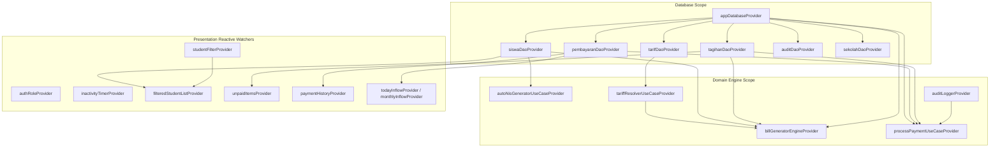

# SIAK-ILMI: System Architecture & Technical Blueprint

> **Document Version:** 1.0.0  
> **Target Specification:** [`/docs/PRD.md`](file:///d:/SIAK-ILMI/docs/PRD.md)  
> **Last Updated:** 2026-10-30  
> **Target Platforms:** Android OS (Smartphones & Tablets)  
> **Framework:** Flutter 3.22+ (Dart SDK 3.4+)

---

## 1. Architectural Principles & System Context

**SIAK-ILMI** (*Sistem Informasi Administrasi dan Keuangan Darul Ilmi*) is engineered as an **offline-first**, **mobile-first** administrative and financial POS system for **SMP IT Darul Ilmi** and **SD IT Baitul Akbar Parabek**.

The system is constructed with three core architectural mandates:
1. **Zero-Latency Offline Execution:** Core cashier transactions, student management, bill creation, and hardware receipt generation must never rely on remote network calls.
2. **Feature-First Clean Architecture:** Strict separation between Presentation, Domain, and Data layers organized by functional feature domain.
3. **Fail-Silent Cloud Decoupling:** Remote synchronization (Google Drive API v3) is isolated behind an abstract service interface; network, OAuth, or cloud timeouts must never interrupt or degrade local POS operations.

---

## 2. High-Level Layered Architecture

```mermaid
graph TD
    subgraph Presentation Layer
        UI_AUTH[PIN Auth Pad & Auto-Lock]
        UI_DASH[Executive Dashboard & Metric Cards]
        UI_STUDENT[Student Registry & Dapodik Import]
        UI_POS[2-Tab Checklist POS Cashier]
        UI_TARIF[Master Tariffs & Custom Schemes]
        UI_BACKUP[Backup & Restore Manager]
    end

    subgraph Domain Layer
        UC_NIS[Auto-NIS Generator Engine]
        UC_TARIFF[Tariff Priority Resolver]
        UC_BILL[Bill Generator & Snapshot Engine]
        UC_PAY[Atomic POS Payment & Void Use Case]
        UC_AUDIT[Centralized Audit Logger]
    end

    subgraph Data Layer
        DB_SQLITE[Typed SQLite via Drift]
        DAO_ALL[6 DAOs: Siswa, Tagihan, Pembayaran, Tarif, Audit, Sekolah]
        ADAPT_PRINT[ESC/POS Bluetooth & A5 PDF Generator]
        ADAPT_PARSE[Excel / CSV Dapodik Parsers]
        ADAPT_BACKUP[Local Zip Archiver & Google Drive v3 Client]
    end

    Presentation Layer --> Domain Layer
    Domain Layer --> Data Layer
```

---

## 3. Layer Breakdown & Component Responsibilities

### 3.1 Presentation Layer (`lib/features/*` & `lib/app/*`)
* **State Management:** Uses **Flutter Riverpod** (`flutter_riverpod`, `riverpod_annotation`). State is reactive, auto-disposing where appropriate, and decoupled from widgets.
* **Routing & Application Shell:**
  * [`lib/app/router.dart`](file:///d:/SIAK-ILMI/lib/app/router.dart): Implements `AppShell` with role-aware rendering. If unauthenticated, displays [`PinAuthScreen`](file:///d:/SIAK-ILMI/lib/features/settings/presentation/pin_auth_screen.dart); once authenticated, wraps [`DashboardScreen`](file:///d:/SIAK-ILMI/lib/features/dashboard/presentation/dashboard_screen.dart) in a pointer `Listener` to dynamically refresh the 5-minute inactivity timer.
* **Styling & Localization:**
  * [`lib/core/theme/app_theme.dart`](file:///d:/SIAK-ILMI/lib/core/theme/app_theme.dart): Material 3 theme with Islamic deep green primary palette (`#1E5631`), verified compatible with Flutter 3.22+ (`CardThemeData`, `.withValues()`).
  * Full Indonesian localization (`id_ID`) configured in [`lib/app/app.dart`](file:///d:/SIAK-ILMI/lib/app/app.dart).

### 3.2 Domain Layer (`lib/features/*/domain`)
The domain layer encapsulates all non-negotiable business rules defined in `/docs/PRD.md`:
1. **Auto-NIS Generator Engine ([`auto_nis_generator_use_case.dart`](file:///d:/SIAK-ILMI/lib/features/students/domain/auto_nis_generator_use_case.dart)):**
   * Computes student NIS using:
     $$\text{NIS} = [\text{YY}] + [\text{SchoolCode}] + [\text{Sequence}]$$
   * Enforces zero-padded 3-digit sequence scoped per school and admission year with ceiling validation ($\le 999$).
2. **Tariff Priority Resolver ([`tariff_resolver_use_case.dart`](file:///d:/SIAK-ILMI/lib/features/fee_management/domain/tariff_resolver_use_case.dart)):**
   * Resolves tuition rate using strict two-tier priority:
     $$\text{Rate} = \begin{cases} \text{skema\_pembayaran\_siswa (Custom Override)}, & \text{if exists} \\ \text{tarif\_master (Standard Grade Rate)}, & \text{fallback} \end{cases}$$
3. **Bill Generator & Snapshot Engine ([`bill_generator_engine.dart`](file:///d:/SIAK-ILMI/lib/features/fee_management/domain/bill_generator_engine.dart)):**
   * Generates `tagihan_siswa` and child `tagihan_item` records.
   * Hardcopies `nominal_awal`, `nominal_diskon`, and `nominal_akhir` directly into SQLite rows.
   * Evaluates PPDB wave promotional discounts (Wave 1: 100%, Wave 2: 50%, Wave 3: Free registration).
   * Validates active student status (`AKTIF` only) and marks 100% discounted items as settled (`is_lunas = 1`).
4. **Process Payment & POS Use Case ([`process_payment_use_case.dart`](file:///d:/SIAK-ILMI/lib/features/payments/domain/process_payment_use_case.dart)):**
   * Atomic execution: Wraps receipt creation, payment allocations, remaining balance reductions, and audit logs within a single `db.transaction()`.
   * Enforces overpayment prevention, positive nominals, item ownership verification, and collision-free receipt sequences (`KW-YYYYMMDD-XXXX`).
   * Provides atomic transaction voiding and reversal rollback logic.

### 3.3 Data Layer (`lib/core/database/*` & `lib/features/*/data`)
* **Local Persistence (Drift SQLite):**
  * Root database: [`lib/core/database/app_database.dart`](file:///d:/SIAK-ILMI/lib/core/database/app_database.dart).
  * Pragmas configured: `PRAGMA foreign_keys = ON;`, `PRAGMA journal_mode = WAL;`.
  * 12 typed SQLite tables and 6 dedicated DAOs.
* **Hardware & Output Adapters:**
  * ESC/POS Bluetooth 58mm Thermal Adapter: [`thermal_printer_adapter.dart`](file:///d:/SIAK-ILMI/lib/features/receipts/data/thermal_printer_adapter.dart).
  * WhatsApp-ready A5 PDF Receipt Generator: [`pdf_receipt_generator.dart`](file:///d:/SIAK-ILMI/lib/features/receipts/data/pdf_receipt_generator.dart).
* **Backup & Cloud Sync:**
  * Abstract contract: [`backup_service.dart`](file:///d:/SIAK-ILMI/lib/features/backup_restore/data/backup_service.dart).
  * Google Drive v3 Adapter: [`drive_backup_adapter.dart`](file:///d:/SIAK-ILMI/lib/features/backup_restore/data/drive_backup_adapter.dart).
  * Both backup implementations issue `PRAGMA wal_checkpoint(FULL);` prior to archive compression.

---

## 4. State Management Architecture (Riverpod)



---

## 5. Security & Inactivity Architecture

1. **Role-Based Access Control (RBAC):**
   * Two discrete profiles: `Admin` (Staf TU) and `Viewer` (Kepala Sekolah).
   * PINs are salted with SHA-256 and stored in `SharedPreferences` ([`pin_service.dart`](file:///d:/SIAK-ILMI/lib/core/security/pin_service.dart)).
   * Critical mutations (student registration, Dapodik bulk import, master tariff editing, POS payments) require `Admin` role validation.
2. **Reactive 5-Minute Inactivity Auto-Lock:**
   * Global pointer listener in [`router.dart`](file:///d:/SIAK-ILMI/lib/app/router.dart) intercepts touches (`HitTestBehavior.translucent`) and dispatches `resetInactivityTimer(ref)`.
   * When 5 minutes elapse without interaction, `authRoleProvider` reverts to `null`, instantly displaying the PIN pad.

---

## 6. Directory Structure

```
lib/
├── app/                              # Top-level application bootstrap and routing
│   ├── app.dart                      # MaterialApp.router with Indonesian locale
│   ├── bootstrap.dart                # Async database init and ProviderScope injection
│   └── router.dart                   # Role-aware router and auto-lock shell
├── core/                             # Foundational application infrastructure
│   ├── database/                     # Drift SQLite database, 12 tables, 6 DAOs, Seeder
│   ├── errors/                       # Sealed domain exceptions
│   ├── formatters/                   # CurrencyFormatter (IDR)
│   ├── security/                     # PinService & Salted SHA-256 logic
│   ├── services/                     # AppInitializer & AuditLoggerService
│   ├── theme/                        # Material 3 Indonesian Islamic Theme
│   └── utils/                        # DateFormatter & InputValidators
└── features/                         # Feature-first functional modules
    ├── backup_restore/               # Local .zip compression & Drive v3 adapter
    ├── dashboard/                    # Executive cash inflow dashboard & metrics
    ├── fee_management/               # Master tariffs, custom rates & bill engine
    ├── payments/                     # 2-tab POS Cashier & atomic transactions
    ├── receipts/                     # Thermal ESC/POS & WhatsApp A5 PDF renderers
    ├── settings/                     # PIN modification & hardware printer config
    └── students/                     # Student registry, Auto-NIS, & Dapodik parser
```
