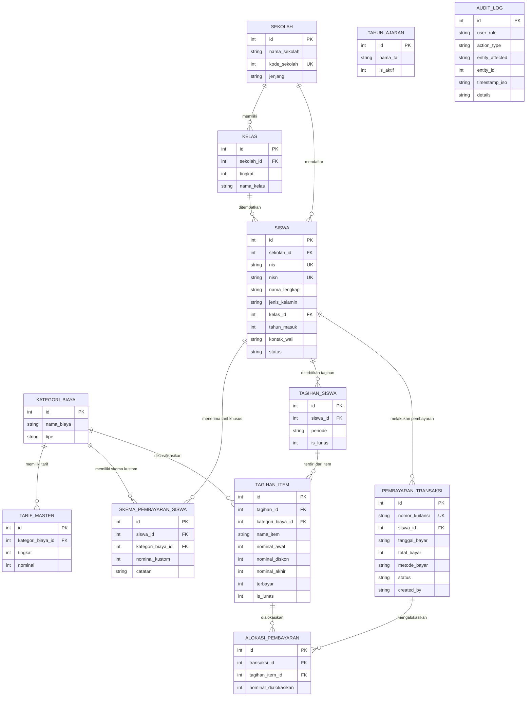

# SIAK-ILMI: Database Design & Schema Specification

> **Document Version:** 1.0.0  
> **Target Specification:** [`/docs/PRD.md`](file:///d:/SIAK-ILMI/docs/PRD.md) Section 8  
> **Last Updated:** 2026-10-30  
> **Database Engine:** SQLite (via Drift 2.18.0)  
> **Pragma Directives:** `PRAGMA foreign_keys = ON;`, `PRAGMA journal_mode = WAL;`

---

## 1. Relational Model & Entity Relationship Diagram (ERD)



---

## 2. Table-by-Table Data Definition Language (DDL)

### 2.1 Table: `sekolah`
Stores institutional entities (SD & SMP).
```sql
CREATE TABLE sekolah (
    id INTEGER PRIMARY KEY AUTOINCREMENT,
    nama_sekolah TEXT NOT NULL,
    kode_sekolah INTEGER NOT NULL UNIQUE, -- 1 for SD, 2 for SMP
    jenjang TEXT NOT NULL                 -- 'SD' or 'SMP'
);
```

### 2.2 Table: `tahun_ajaran`
Maintains academic year definitions and the active cycle.
```sql
CREATE TABLE tahun_ajaran (
    id INTEGER PRIMARY KEY AUTOINCREMENT,
    nama_ta TEXT NOT NULL,                -- e.g., '2026/2027'
    is_aktif INTEGER NOT NULL DEFAULT 1   -- 1 = True, 0 = False
);
```

### 2.3 Table: `kelas`
Represents grade and class sections tied to school entities.
```sql
CREATE TABLE kelas (
    id INTEGER PRIMARY KEY AUTOINCREMENT,
    sekolah_id INTEGER NOT NULL REFERENCES sekolah(id),
    tingkat INTEGER NOT NULL,             -- 1..6 for SD, 7..9 for SMP
    nama_kelas TEXT NOT NULL
);
```

### 2.4 Table: `kategori_biaya`
Defines fee types, categorizing them as routine or single-occurrence.
```sql
CREATE TABLE kategori_biaya (
    id INTEGER PRIMARY KEY AUTOINCREMENT,
    nama_biaya TEXT NOT NULL,             -- 'SPP', 'Infaq Gedung', 'Pendaftaran', etc.
    tipe TEXT NOT NULL                    -- 'Rutin' or 'Sekali'
);
```

### 2.5 Table: `siswa`
Core student master registry with auto-generated NIS and lifecycle statuses.
```sql
CREATE TABLE siswa (
    id INTEGER PRIMARY KEY AUTOINCREMENT,
    sekolah_id INTEGER NOT NULL REFERENCES sekolah(id),
    nis TEXT NOT NULL UNIQUE,             -- Format: [YY][SchoolCode][Sequence]
    nisn TEXT UNIQUE,                     -- Optional Dapodik NISN
    nama_lengkap TEXT NOT NULL,
    jenis_kelamin TEXT NOT NULL,          -- 'L' or 'P'
    kelas_id INTEGER NOT NULL REFERENCES kelas(id),
    tahun_masuk INTEGER NOT NULL,         -- e.g., 2026
    kontak_wali TEXT,
    status TEXT NOT NULL DEFAULT 'AKTIF'  -- 'AKTIF', 'LULUS', 'PINDAH', 'DROP_OUT'
);
```

### 2.6 Table: `tarif_master`
Baseline fee rates mapped by fee category and grade level.
```sql
CREATE TABLE tarif_master (
    id INTEGER PRIMARY KEY AUTOINCREMENT,
    kategori_biaya_id INTEGER NOT NULL REFERENCES kategori_biaya(id),
    tingkat INTEGER NOT NULL,             -- Grade level (1..9)
    nominal INTEGER NOT NULL              -- Baseline price in IDR
);
```

### 2.7 Table: `skema_pembayaran_siswa`
Operator customization table overriding master rates for individual students.
```sql
CREATE TABLE skema_pembayaran_siswa (
    id INTEGER PRIMARY KEY AUTOINCREMENT,
    siswa_id INTEGER NOT NULL REFERENCES siswa(id),
    kategori_biaya_id INTEGER NOT NULL REFERENCES kategori_biaya(id),
    nominal_kustom INTEGER NOT NULL,       -- Overrides tarif_master
    catatan TEXT
);
```

### 2.8 Table: `tagihan_siswa`
Header table representing a billing cycle for a student.
```sql
CREATE TABLE tagihan_siswa (
    id INTEGER PRIMARY KEY AUTOINCREMENT,
    siswa_id INTEGER NOT NULL REFERENCES siswa(id),
    periode TEXT NOT NULL,                -- e.g., 'Oktober 2026' or 'PPDB 2026/2027'
    is_lunas INTEGER NOT NULL DEFAULT 0   -- 1 = True, 0 = False
);
```

### 2.9 Table: `tagihan_item`
Core line-item table storing **hardcopy snapshots** of base fees, discounts, and paid balances.
```sql
CREATE TABLE tagihan_item (
    id INTEGER PRIMARY KEY AUTOINCREMENT,
    tagihan_id INTEGER NOT NULL REFERENCES tagihan_siswa(id) ON DELETE CASCADE,
    kategori_biaya_id INTEGER NOT NULL REFERENCES kategori_biaya(id),
    nama_item TEXT NOT NULL,              -- Snapshotted item title
    nominal_awal INTEGER NOT NULL,        -- Baseline snapshot price
    nominal_diskon INTEGER NOT NULL DEFAULT 0, -- Applied promotional discount
    nominal_akhir INTEGER NOT NULL,       -- Net target amount (nominal_awal - nominal_diskon)
    terbayar INTEGER NOT NULL DEFAULT 0,  -- Accumulated payments
    is_lunas INTEGER NOT NULL DEFAULT 0   -- 1 when terbayar == nominal_akhir
);
```

### 2.10 Table: `pembayaran_transaksi`
Transaction header recording financial receipts.
```sql
CREATE TABLE pembayaran_transaksi (
    id INTEGER PRIMARY KEY AUTOINCREMENT,
    nomor_kuitansi TEXT NOT NULL UNIQUE,  -- 'KW-YYYYMMDD-XXXX'
    siswa_id INTEGER NOT NULL REFERENCES siswa(id),
    tanggal_bayar TEXT NOT NULL,          -- ISO8601 string e.g., '2026-10-30T10:15:00'
    total_bayar INTEGER NOT NULL,         -- Total amount paid
    metode_bayar TEXT NOT NULL,           -- 'Tunai' or 'Transfer'
    status TEXT NOT NULL DEFAULT 'VALID', -- 'VALID' or 'VOID'
    created_by TEXT NOT NULL              -- 'Admin' or 'Kepala Sekolah'
);
```

### 2.11 Table: `alokasi_pembayaran`
Junction table routing payment amounts to specific checklist bill items.
```sql
CREATE TABLE alokasi_pembayaran (
    id INTEGER PRIMARY KEY AUTOINCREMENT,
    transaksi_id INTEGER NOT NULL REFERENCES pembayaran_transaksi(id) ON DELETE CASCADE,
    tagihan_item_id INTEGER NOT NULL REFERENCES tagihan_item(id),
    nominal_dialokasikan INTEGER NOT NULL -- Amount applied to this line item
);
```

### 2.12 Table: `audit_log`
Append-only audit trail logging all sensitive system mutations.
```sql
CREATE TABLE audit_log (
    id INTEGER PRIMARY KEY AUTOINCREMENT,
    user_role TEXT NOT NULL,              -- 'Admin' or 'Kepala Sekolah'
    action_type TEXT NOT NULL,            -- 'INSERT_PAYMENT', 'VOID_TRANSACTION', etc.
    entity_affected TEXT NOT NULL,
    entity_id INTEGER,
    timestamp_iso TEXT NOT NULL,
    details TEXT
);
```

---

## 3. Indexes & Performance Optimization

```sql
CREATE INDEX idx_siswa_sekolah ON siswa(sekolah_id);
CREATE INDEX idx_siswa_kelas ON siswa(kelas_id);
CREATE INDEX idx_tagihan_item_tagihan ON tagihan_item(tagihan_id);
CREATE INDEX idx_alokasi_transaksi ON alokasi_pembayaran(transaksi_id);
CREATE INDEX idx_pembayaran_siswa ON pembayaran_transaksi(siswa_id);
```

---

## 4. Data Access Objects (DAOs) Implementation

All SQLite access is partitioned across 6 typed Drift DAOs:

1. **`SiswaDao` ([`siswa_dao.dart`](file:///d:/SIAK-ILMI/lib/core/database/daos/siswa_dao.dart)):**
   * Reactive watchers: `watchActiveSiswa()`, `watchActiveSiswaBySekolah(sekolahId)`.
   * Lookups: `getById(id)`, `getByNis(nis)`, `getByNisn(nisn)`.
   * Auto-NIS helper: `countSiswaBySekolahAndTahun(sekolahId, tahunMasuk)`.
   * Status mutation: `updateStatus(id, status)`.

2. **`TagihanDao` ([`tagihan_dao.dart`](file:///d:/SIAK-ILMI/lib/core/database/daos/tagihan_dao.dart)):**
   * Unpaid item watcher: `watchUnpaidItemsBySiswa(siswaId)`.
   * Balance allocation: `applyPaymentToItem(itemId, amount)`.
   * Void reversal: `reversePaymentOnItem(itemId, amount)`.
   * Header completion: Automatically checks child items and sets `tagihan_siswa.is_lunas = 1`.

3. **`PembayaranDao` ([`pembayaran_dao.dart`](file:///d:/SIAK-ILMI/lib/core/database/daos/pembayaran_dao.dart)):**
   * History watcher: `watchTransaksiBySiswa(siswaId)`.
   * Date range collection: `sumTotalBayarByDateRange(start, end, {sekolahId})`.
   * Collision-free sequence generator: `countTransaksiToday(datePrefix)` counts all rows to prevent sequence collisions after a transaction void.

4. **`TarifDao` ([`tarif_dao.dart`](file:///d:/SIAK-ILMI/lib/core/database/daos/tarif_dao.dart)):**
   * Master rate lookup: `getTarifMaster(kategoriBiayaId, tingkat)`.
   * Custom rate lookup & override: `getCustomTarif(siswaId, kategoriBiayaId)`, `upsertCustomTarif(...)`, `deleteCustomTarif(...)`.

5. **`SekolahDao` ([`sekolah_dao.dart`](file:///d:/SIAK-ILMI/lib/core/database/daos/sekolah_dao.dart)):**
   * Lookup: `getAllSekolah()`, `getSekolahById(id)`, `getKelasBySekolah(sekolahId)`.

6. **`AuditDao` ([`audit_dao.dart`](file:///d:/SIAK-ILMI/lib/core/database/daos/audit_dao.dart)):**
   * Append-only logger: `log(...)`.
   * History reader: `getRecentLogs(limit)`.

---

## 5. Hardcopy Snapshotting Guarantee & Immutability Pattern

When bills are generated, the resolved baseline rate and discounts are calculated once and stored directly in `tagihan_item`:
* `nominal_awal`: Snapshot of base tariff at generation time.
* `nominal_diskon`: Snapshot of promotion or wave discount.
* `nominal_akhir`: Computed net amount (`nominal_awal - nominal_diskon`).

**Non-Negotiable Rule:**
Subsequent changes to `tarif_master` or `skema_pembayaran_siswa` never affect previously created `tagihan_item` records. This ensures historical accounting records remain immutable.
