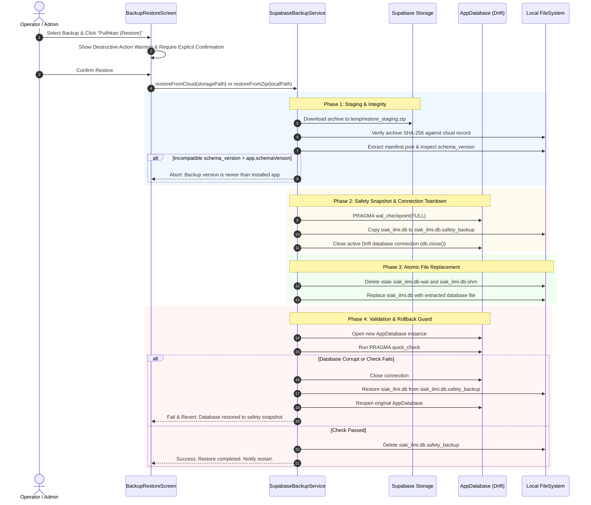

# Technical Migration Plan: Google Drive to Supabase Storage Backup Adapter

> **Document Status:** PROPOSED / PENDING APPROVAL  
> **Document Version:** 1.0.0  
> **Target Application:** SIAK-ILMI (*Sistem Informasi Administrasi dan Keuangan Darul Ilmi*)  
> **Author:** Senior Flutter Software Architect & Database/Cloud Infrastructure Engineer  
> **Date:** 2026-11-20  

---

## Executive Summary

SIAK-ILMI is a mobile-first, offline-first student administration and financial POS management system engineered for **SMP IT Darul Ilmi** and **SD IT Baitul Akbar Parabek**. It runs locally on 1–3 Android cashier tablets managing fewer than 100 students using an offline-first SQLite database powered by the Drift ORM.

The existing cloud backup integration relies on Google Drive API v3 via `google_sign_in` and `googleapis`. In production and field testing, this integration has proven brittle and unreliable, specifically failing with `PlatformException(sign_in_failed, com.google.android.gms.common.api.ApiException: 10, null, null)` (`CommonStatusCodes.DEVELOPER_ERROR`) due to Android keystore SHA-1 certificate mismatches, dependency on Google Play Services, and per-user personal Google account authorization friction.

This document presents a comprehensive, production-grade technical migration plan to replace the Google Drive adapter with **Supabase Storage** and an optional lightweight metadata registry. The migration strictly preserves:
1. **Offline-first core operation:** 100% functionality without internet.
2. **Local ZIP archive format:** Standalone portability on device storage.
3. **Drift SQLite relational schema:** No conversion to remote PostgreSQL.
4. **Clean Architecture boundaries:** Swapping implementation behind the abstract `BackupService` interface.

---

## 1. Documentation vs. Source Code Audit

A comparative audit was conducted between the project specifications ([`PRD.md`](file:///d:/SIAK-ILMI/docs/PRD.md), [`ARCHITECTURE.md`](file:///d:/SIAK-ILMI/docs/ARCHITECTURE.md), [`AGENTS.md`](file:///d:/SIAK-ILMI/AGENTS.md)) and the current source code implementation.

| Item | Documented Specification | Actual Source Code Status | Discrepancy / Risk |
|---|---|---|---|
| **Architecture Contract** | Isolated behind `BackupService` interface | Implemented in `backup_service.dart` and `drive_backup_adapter.dart` | Documented correctly; Clean Architecture contract is preserved. |
| **Fail-Silent Policy** | Cloud errors must never crash or throw (PRD Rule #1) | Handled via try-catch returning `BackupResult(cloudError: ...)` | Compliant. |
| **WAL Checkpoint** | Full WAL checkpoint executed prior to zipping | `PRAGMA wal_checkpoint(FULL);` executed before zipping | Compliant, but WAL/SHM file cleanup on restore is missing in code. |
| **Google Drive Fallback** | PRD Section 6.2 explicitly lists Supabase Storage as Option A fallback | Not yet implemented; Drive adapter is currently active | Planned in PRD; this migration fulfills Option A. |
| **Restore Procedure** | Documented as file-based restore | `restoreFromZip` overwrites `siak_ilmi.db` directly without closing active Drift connection | **Critical Gap:** Overwriting open SQLite file in WAL mode causes data corruption risk. |
| **Safety Backup on Restore** | Implied data safety | Not implemented in current codebase | **Critical Gap:** If restored zip is corrupt, original data is irretrievably lost. |
| **Checksum / Integrity** | Implied verification | Only file existence and entry name checked | **Critical Gap:** No SHA-256 hash or CRC verification. |

---

## 2. Deep Source Code & Architecture Inspection

### 2.1 Database Architecture (Drift / SQLite)
- **Database Entry Point:** [`lib/core/database/app_database.dart`](file:///d:/SIAK-ILMI/lib/core/database/app_database.dart)
- **Database File Location:** `p.join(getApplicationDocumentsDirectory().path, 'siak_ilmi.db')`
- **Auxiliary Files:** When operating in WAL mode, SQLite generates:
  - `siak_ilmi.db` (main relational database file)
  - `siak_ilmi.db-wal` (Write-Ahead Log containing uncommitted and committed un-checkpointed pages)
  - `siak_ilmi.db-shm` (shared-memory index for WAL coordination)
- **Connection Lifecycle:**
  - Instantiated once in [`lib/core/services/app_initializer.dart`](file:///d:/SIAK-ILMI/lib/core/services/app_initializer.dart) via `AppDatabase()`.
  - Injected as an immutable provider override in `ProviderScope` ([`lib/app/bootstrap.dart`](file:///d:/SIAK-ILMI/lib/app/bootstrap.dart)):
    ```dart
    ProviderScope(
      overrides: [
        appDatabaseProvider.overrideWithValue(db),
      ],
      child: const SiakIlmiApp(),
    )
    ```
  - **Limitation:** Because `appDatabaseProvider` is a plain `Provider<AppDatabase>` overridden with a static instance, hot-swapping the database connection at runtime without app restart is not supported by the current Riverpod setup.
- **Pragmas & Schema:**
  - `PRAGMA foreign_keys = ON;`
  - `PRAGMA journal_mode = WAL;`
  - Schema Version: `3` (v1: 12 tables + indexes, v2: `operator_account`, v3: `nip` column).

### 2.2 Local ZIP Backup Implementation
- **Implementation Location:** 
  - [`lib/features/backup_restore/data/backup_service.dart`](file:///d:/SIAK-ILMI/lib/features/backup_restore/data/backup_service.dart) (`BackupServiceImpl`)
  - [`lib/features/backup_restore/data/drive_backup_adapter.dart`](file:///d:/SIAK-ILMI/lib/features/backup_restore/data/drive_backup_adapter.dart) (`DriveBackupService`)
- **Execution Flow:**
  1. Executes `await _db.customStatement('PRAGMA wal_checkpoint(FULL);');`.
  2. Resolves database file at `getApplicationDocumentsDirectory() / 'siak_ilmi.db'`.
  3. Resolves output directory: External Storage `Download/SIAK-ILMI-Backup/` with fallback to `app_docs/backups/`.
  4. Generates archive name: `SIAK_ILMI_Backup_YYYY-MM-DDTHH-mm-ss.zip`.
  5. Uses `archive` package (`ZipFileEncoder`) to pack `siak_ilmi.db`.
- **Identified Deficiencies:**
  - `siak_ilmi.db-wal` and `siak_ilmi.db-shm` are ignored; if `PRAGMA wal_checkpoint(FULL);` is busy or fails silently, dirty pages in WAL are excluded.
  - No archive manifest or metadata JSON (schema version, student count, hash, app version).
  - No archive-level checksum calculation.

### 2.3 Existing Google Drive Cloud Adapter
- **Dependencies:** `google_sign_in: ^6.2.1`, `googleapis: ^13.2.0`, `http: ^1.2.1`.
- **Implementation Location:** [`lib/features/backup_restore/data/drive_backup_adapter.dart`](file:///d:/SIAK-ILMI/lib/features/backup_restore/data/drive_backup_adapter.dart)
- **Execution Flow:**
  1. Requests `signInSilently()` then `signIn()` with scope `https://www.googleapis.com/auth/drive.file`.
  2. Extracts bearer token headers from `GoogleSignInAccount.authHeaders`.
  3. Queries Drive for folder `SIAK-ILMI-Backups`; creates it if missing.
  4. Streams local `.zip` file via `drive.Media(file.openRead(), file.lengthSync())`.
  5. Lists files using `driveApi.files.list(q: "'$folderId' in parents and trashed=false")`.
- **Why Google Drive Fails in Practice:**
  1. **`ApiException: 10` (DEVELOPER_ERROR):** Requires registering SHA-1 fingerprints for every machine building the APK (debug, release, CI/CD) in Google Cloud Console under an OAuth 2.0 Android Client ID. Any new developer or keystore immediately breaks authentication.
  2. **Play Services Dependency:** Devices lacking Google Play Services or with outdated microG cannot authenticate.
  3. **Personal Account Contamination:** Cashier operators are prompted to log in with their personal `@gmail.com` accounts, creating security and ownership issues for school records.

### 2.4 Existing Restore Implementation
- **Implementation Location:** `DriveBackupService.restoreFromZip(String zipPath)` and `BackupServiceImpl.restoreFromZip(String zipPath)`.
- **Current Procedure:**
  ```dart
  final bytes = await zipFile.readAsBytes();
  final archive = ZipDecoder().decodeBytes(bytes);
  // finds entry 'siak_ilmi.db'
  await dbFile.writeAsBytes(extractedBytes, flush: true);
  ```
- **Critical Flaws & Risks:**
  1. **Connection Collision:** Drift `AppDatabase` is open with active locks. Writing raw bytes directly to `siak_ilmi.db` while active connection handles exist can trigger SQLite operating system locking errors (`EBUSY` / `SQLITE_BUSY`).
  2. **WAL Desynchronization:** Overwriting the main DB file while leaving stale `siak_ilmi.db-wal` and `siak_ilmi.db-shm` files causes SQLite on next query to attempt WAL recovery against mismatched pages, leading to catastrophic database corruption.
  3. **No Rollback Protection:** There is no backup of the current database before the overwrite. If the archive is corrupt, data is permanently erased.

---

## 3. Target Architecture: Supabase Storage Integration

### 3.1 Architectural Overview

```
                      ┌──────────────────────────────────────┐
                      │    Presentation Layer (Flutter UI)    │
                      │  BackupRestoreScreen / SettingsScreen │
                      └──────────────────┬───────────────────┘
                                         │ Calls
                                         ▼
                      ┌──────────────────────────────────────┐
                      │       BackupService (Contract)        │
                      └──────────────────┬───────────────────┘
                                         │ Implemented by
                                         ▼
                      ┌──────────────────────────────────────┐
                      │       SupabaseBackupService          │
                      │  (Concrete Clean Architecture Impl)  │
                      └──────┬────────────────────────┬──────┘
                             │                        │
             1. Local Operations                      │ 2. Cloud Operations
                             ▼                        ▼
        ┌──────────────────────────────┐    ┌───────────────────────────────┐
        │   Local Backup & Restore     │    │   Supabase Cloud Client       │
        │ - PRAGMA wal_checkpoint      │    │ - Supabase Storage Bucket     │
        │ - ZIP Generation + SHA-256   │    │   (private: siak-ilmi-backups)│
        │ - Pre-restore Safety Backup  │    │ - RLS Protected Upload/List   │
        │ - Safe Connection Swapping   │    │ - Metadata Registry Table     │
        └──────────────┬───────────────┘    └───────────────┬───────────────┘
                       │                                    │
                       ▼                                    ▼
        ┌──────────────────────────────┐    ┌───────────────────────────────┐
        │   SQLite / Drift Database    │    │  Supabase Cloud Infrastructure│
        │   (siak_ilmi.db + WAL/SHM)   │    │   (PostgREST / S3 Storage)    │
        └──────────────────────────────┘    └───────────────────────────────┘
```

### 3.2 Supabase Authentication & Device Access Strategy

#### Authentication Model
- **Constraint:** 1–3 cashier tablets for SMP IT Darul Ilmi & SD IT Baitul Akbar. No complex multi-tenant hierarchy is required.
- **Recommended Model:** **Service Account / Institutional Credential Flow (Email & Password)** via `supabase_flutter`.
  - The school IT administrator creates a dedicated backup account in Supabase Auth: e.g., `backup@darulilmi.sch.id`.
  - Cashier tablets authenticate using this credential once.
  - The session token (`access_token` and `refresh_token`) is stored securely on the device using `flutter_secure_storage` / Supabase's built-in secure session persistence.
  - **Key Security Rule:** The Flutter application MUST ONLY possess the Supabase `anonKey` (Public Anon Key) and the authenticated user JWT. **NEVER expose the `service_role` key in client code.**

### 3.3 Storage Bucket & Row Level Security (RLS) Configuration

#### Bucket Configuration
- **Bucket Name:** `siak-ilmi-backups`
- **Public:** `false` (Strictly private bucket)
- **Allowed MIME types:** `application/zip`, `application/octet-stream`
- **File Size Limit:** `50 MB` (Current SQLite DB for < 100 students is < 1 MB; 50 MB provides 10+ years of headroom)

#### Cloud Storage Path Organization
```
siak-ilmi-backups/
  ├── sekolah_1_sd/
  │     ├── SIAK_BACKUP_20261120_120000_v3.zip
  │     └── SIAK_BACKUP_20261121_080000_v3.zip
  └── institutional/
        └── SIAK_BACKUP_20261120_120000_v3.zip
```
Standardizing on an institutional path:
`backups/{year}/{month}/SIAK_BACKUP_{timestamp}_v{schemaVersion}.zip`

#### Storage RLS Policies (SQL)
```sql
-- Enable RLS on storage.objects
ALTER TABLE storage.objects ENABLE ROW LEVEL SECURITY;

-- Allow authenticated school users to upload backups
CREATE POLICY "Allow authenticated school backup upload"
ON storage.objects FOR INSERT
TO authenticated
WITH CHECK (
  bucket_id = 'siak-ilmi-backups' AND
  (storage.extension(name) = 'zip')
);

-- Allow authenticated school users to view/list backups
CREATE POLICY "Allow authenticated school backup list"
ON storage.objects FOR SELECT
TO authenticated
USING (
  bucket_id = 'siak-ilmi-backups'
);

-- Deny public modifications or deletions
CREATE POLICY "Deny delete for safety"
ON storage.objects FOR DELETE
TO authenticated
USING (false); -- Deletions only allowed via Supabase Dashboard admin
```

### 3.4 Optional Cloud Backup Metadata Table (PostgreSQL)
To allow instant listing without parsing large directory trees and to store file integrity checksums:

```sql
CREATE TABLE public.backup_records (
    id UUID PRIMARY KEY DEFAULT gen_random_uuid(),
    file_name TEXT NOT NULL,
    storage_path TEXT NOT NULL UNIQUE,
    file_size_bytes BIGINT NOT NULL,
    sha256_checksum TEXT NOT NULL,
    schema_version INTEGER NOT NULL,
    total_students INTEGER,
    total_transactions INTEGER,
    created_by_operator TEXT NOT NULL,
    device_info TEXT,
    created_at TIMESTAMPTZ DEFAULT NOW()
);

ALTER TABLE public.backup_records ENABLE ROW LEVEL SECURITY;

CREATE POLICY "Allow authenticated read backup records"
ON public.backup_records FOR SELECT TO authenticated USING (true);

CREATE POLICY "Allow authenticated insert backup records"
ON public.backup_records FOR INSERT TO authenticated WITH CHECK (true);
```

---

## 4. Enhanced Archive Format & Integrity Specification

### 4.1 Archive Manifest (`manifest.json`)
Instead of packing only raw `siak_ilmi.db`, the ZIP archive should contain:
```
SIAK_BACKUP_20261120_120000_v3.zip
  ├── manifest.json
  └── siak_ilmi.db
```

#### Manifest Structure
```json
{
  "format_version": 1,
  "app_version": "1.0.1+2",
  "schema_version": 3,
  "created_at_utc": "2026-11-20T05:00:00.000Z",
  "created_by": "Administrator",
  "database_file": "siak_ilmi.db",
  "database_sha256": "e3b0c44298fc1c149afbf4c8996fb92427ae41e4649b934ca495991b7852b855",
  "record_counts": {
    "siswa": 45,
    "pembayaran_transaksi": 112,
    "tagihan_item": 270
  }
}
```

### 4.2 Checksum Verification
- Calculate SHA-256 hash of `siak_ilmi.db` before packaging.
- Calculate SHA-256 hash of the final `.zip` file.
- When uploading to Supabase, store the checksum in object metadata or `backup_records`.
- Prior to restore, recalculate the SHA-256 hash to guarantee zero bit-rot or network corruption.

---

## 5. Comprehensive Safe Restore Sequence (Data Loss Prevention)



---

## 6. Implementation Scope & File Breakdown

### 6.1 Files to be Modified
| Exact File Path | Current Responsibility | Required Modification | Rationale |
|---|---|---|---|
| [`pubspec.yaml`](file:///d:/SIAK-ILMI/pubspec.yaml) | Project dependencies | Add `supabase_flutter: ^2.8.0`, remove `google_sign_in` and `googleapis` | Replace Google APIs with official Supabase Flutter SDK |
| [`lib/features/backup_restore/data/backup_service.dart`](file:///d:/SIAK-ILMI/lib/features/backup_restore/data/backup_service.dart) | Core interface & local backup fallback | Update `BackupResult` and `BackupService` interface to support checksums and cloud backup metadata | Clean Architecture contract update |
| [`lib/features/backup_restore/presentation/backup_restore_screen.dart`](file:///d:/SIAK-ILMI/lib/features/backup_restore/presentation/backup_restore_screen.dart) | Backup & Restore UI | Replace Google Drive status card with Supabase connection card; display Supabase cloud backup list; integrate safe restore dialog | Align UI with Supabase authentication and cloud files |
| [`lib/features/settings/presentation/settings_screen.dart`](file:///d:/SIAK-ILMI/lib/features/settings/presentation/settings_screen.dart) | Settings UI & quick backup | Update result status text from "Google Drive" to "Supabase Cloud" | Maintain accurate UI labels |
| [`lib/core/database/app_database.dart`](file:///d:/SIAK-ILMI/lib/core/database/app_database.dart) | Drift SQLite Database | Add connection close/reopen lifecycle management helper for restore | Prevent database corruption during file replacement |

### 6.2 New Files to be Created
| File Path | Planned Responsibility |
|---|---|
| `lib/features/backup_restore/data/supabase_backup_adapter.dart` | Concrete `SupabaseBackupService` implementing `BackupService` using `SupabaseClient` (upload, download, list, delete, safe restore) |
| `lib/core/config/supabase_config.dart` | Supabase URL and Anon Key configuration constants with compile-time or local asset fallback |
| `test/unit/supabase_backup_test.dart` | Unit tests for Supabase adapter, SHA-256 verification, manifest parser, and safe rollback |

### 6.3 Files to Remain Untouched
- All Financial & POS Engines: `process_payment_use_case.dart`, `bill_generator_engine.dart`, `tariff_resolver_use_case.dart`, `bulk_billing_use_case.dart`, `promote_students_use_case.dart`.
- All DAOs and Tables: `siswa_dao.dart`, `tagihan_dao.dart`, `pembayaran_dao.dart`, `tarif_dao.dart`, `operator_dao.dart`, etc.
- All POS & Student UI: `pos_checklist_screen.dart`, `student_list_screen.dart`, `student_detail_screen.dart`, `fee_management_screen.dart`.
- All Receipt Generators: `pdf_receipt_generator.dart`, `thermal_printer_adapter.dart`, `terbilang.dart`.

---

## 7. Step-by-Step Implementation Sequence

```
[Step 1: Configuration & Credentials Setup]
  ├── Set up Supabase project & create private bucket 'siak-ilmi-backups'
  ├── Apply RLS policies for authenticated access
  └── Create lib/core/config/supabase_config.dart (URL & anonKey)

[Step 2: Add Dependencies & Clean pubspec.yaml]
  ├── Add supabase_flutter: ^2.8.0
  └── Verify 0 conflicts with existing crypto, archive, drift packages

[Step 3: Develop SupabaseBackupService]
  ├── Implement BackupService interface in supabase_backup_adapter.dart
  ├── Implement manifest generation (manifest.json + SHA-256)
  ├── Implement fail-silent uploadToSupabase()
  ├── Implement listCloudBackups() & downloadCloudBackup()
  └── Implement safe 10-step restoreFromZip() with rollback guard

[Step 4: Update Database Lifecycle & Riverpod Providers]
  ├── Expose safe restart / close hooks on AppDatabase
  └── Point backupServiceProvider to supabaseBackupServiceProvider

[Step 5: Refactor UI (BackupRestoreScreen)]
  ├── Build Supabase account status card (Email login / connection indicator)
  ├── Add cloud backup browser showing Supabase files (size, date, SHA-256)
  └── Wire "Pulihkan dari Cloud" and "Pulihkan dari File Lokal" actions

[Step 6: Deprecate Google Drive Code]
  ├── Safely remove google_sign_in and googleapis from pubspec.yaml
  └── Remove legacy drive_backup_adapter.dart or mark as deprecated

[Step 7: Testing & Quality Assurance]
  ├── Run unit tests for backup generation, checksum validation, and restore
  ├── Run flutter analyze (enforce 0 issues)
  └── Run flutter test (enforce 100% pass rate)
```

---

## 8. Testing Strategy

1. **Unit Tests (`test/unit/supabase_backup_test.dart`):**
   - Test `manifest.json` generation and serialization.
   - Test SHA-256 checksum verification against corrupted byte streams.
   - Test schema version gate (reject restore if archive version > current version).
   - Test rollback mechanism (ensure safety snapshot is restored if simulated corruption occurs).
2. **Integration Tests (`test/integration/offline_pos_flow_test.dart`):**
   - Verify `performBackup()` creates valid local `.zip` with Airplane Mode simulated.
   - Verify cloud upload failures fail silently without throwing exceptions or blocking POS checkout.
3. **Static Analysis:**
   - Execute `flutter analyze` ensuring 0 errors, 0 warnings, 0 lints.

---

## 9. Rollback & Contingency Strategy

If Supabase Storage experiences service degradation or network connectivity issues in the field:
1. **Local ZIP Safety Guarantee:** Every backup operation unconditionally creates the local `.zip` file on external storage *before* cloud synchronization is attempted. Cashiers can continue operating 100% offline.
2. **Local Manual Restore:** The "Pulihkan Zip" button allows administrators to restore from any local `.zip` file or USB drive without requiring an internet connection or cloud access.
3. **Decoupled Architecture:** Because all calls route through the abstract `BackupService` interface, the cloud adapter can be modified or redirected with zero changes to core POS or student management screens.

---

## 10. Conclusion & Request for Approval

This migration plan eliminates the persistent `ApiException: 10` errors and Google Play Services fragility by establishing a dedicated, robust, and secure cloud backup pipeline via **Supabase Storage**. All non-negotiable PRD requirements—offline-first integrity, immutable fees, local ZIP preservation, and fail-silent cloud execution—are fully safeguarded.

*Awaiting explicit user approval before beginning implementation.*
